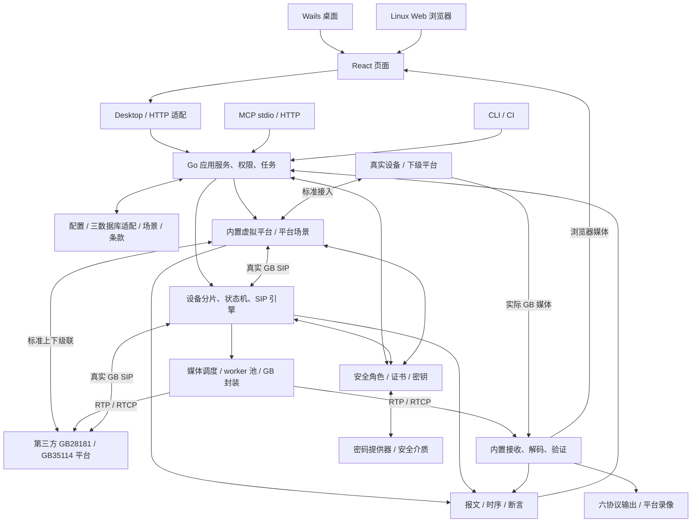
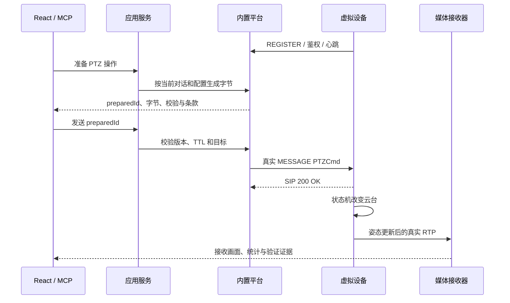

# GB28181 Lab 设计文档

| 项目 | 内容 |
| --- | --- |
| 项目 / 工程 | GB28181 Lab / `gb28181-lab` |
| 中文名称 | 国标视频协议模拟实验室 |
| 文档维护 | 随 main 持续更新；原始设计基线 2026-09-15，组织方式更新 2026-10-07 |
| 需求基线 | [GB28181 Lab 需求文档](requirements.md) |
| 设计状态 | 独立实现基线；宿主、媒体与容量须通过原型验证 |

本设计覆盖 GB/T 28181-2022 与 GB 35114-2017 的 Go 设备 / 平台 / 安全终端、Wails 桌面、Linux Web、React、媒体、配置与自动化。实现、产品规则和测试由本仓库独立维护，标准原始资料集中维护。[GB28181 PDF](https://github.com/chialecaleb/gb28181-workspace/blob/main/docs/standards/GBT28181-2022/GBT28181-2022.pdf)、[GB35114 PDF](https://github.com/chialecaleb/gb28181-workspace/blob/main/docs/standards/GB35114-2017/GB35114-2017.pdf) 为条款来源；未特别标为标准值的超时、资源限额和部署参数均为产品初始策略。功能去重见需求第 1.1 节，新增 LAB-S / E / X 与设计的对应关系见本设计第 15 节。

## 1. 技术决策与模块边界

2026-10-07 M0 调整：用户将技术栈、参考图功能规划、基础框架和 REGISTER / Keepalive / DeviceInfo / Catalog 提前至 M0。实际实施顺序与缺项见 [M0 计划](delivery/m0-plan.md)，原页核对和测试契约见 [协议调研](delivery/m0-protocol.md)。工程与四信令切片已经实施，2026-10-11 补齐两种模式和兼容外测；接口、存储和生命周期见 [M0 实现合同](delivery/m0-implementation.md)，当前验证与标准模式对端差异见状态页。最小核心经 sipgo 适配、GB 独立规则、统一 AppService、SQLite 最小配置和薄宿主形成切片；媒体、安全与其他产品承诺保留。

| 决策 | 选定方案 | 约束 |
| --- | --- | --- |
| LAB-D-01 | Go 核心 + 标准网络 I/O + 自有 SIP / GB 引擎接口 | 内核不 import Wails、HTTP handler 或 MCP SDK，不依赖 GUI 生命周期 |
| LAB-D-02 | Wails v2 桌面宿主；独立 Go HTTP 生产宿主 | 已查证 v2.15.0 模块标签，Release/文档差异见技术栈页；已在 M0 锁定并完成 Windows 构建/启动，不以开发服务器充当 Linux 生产交付 |
| LAB-D-03 | React + TypeScript + Vite | UI 仅调用统一应用接口，经 desktop / HTTP adapter 适配 |
| LAB-D-04 | 默认 SQLite3 WAL，可配置 MySQL / PostgreSQL；统一存储契约 | SQLite 单写，三库功能等价；活跃 SIP 和高频 PTZ 不逐事件同步写库，数据库切换不改变单引擎所有权 |
| LAB-D-05 | 设备为紧凑状态对象，分片 mailbox 和共享定时器 | 不为每个空闲设备创建专属工作进程或常驻业务 goroutine |
| LAB-D-06 | 独立媒体 worker 池，FFmpeg/libav 作为原型与编解码后端 | Go 调度 / GB 封装与原生图像处理分开；worker 崩溃不结束全部设备 |
| LAB-D-07 | 内置平台经真实回环 / 网络 SIP 连接设备 | 禁止直接调用设备动作伪装成标准控制 |
| LAB-D-08 | MCP stdio / Streamable HTTP 复用应用服务 | 当前规范研读基线为 2026-07-28，SDK 1.8.0 仅作调研基线；M0 不实现 MCP，客户端矩阵后续验证 |
| LAB-D-09 | 所有素材、字段、规则、场景版本化 | 同一配置、seed、素材 hash 和引擎版本可复现相同仿真内容 |
| LAB-D-10 | GB35114 规则与真实密码提供器、证书 / 密钥服务独立建模 | A / B / C 全部实现；软件实验与合规密码产品剖面分开，禁止假签名或跳过校验 |
| LAB-D-11 | 平台产品服务复用 AppService | 六协议、分屏轮巡、实录、账号 / SSO、HTTP / MCP 使用同一授权与资源治理 |
| LAB-D-12 | CLI 场景运行、证据报告与故障注入 | 无 GUI 可验收，安全异常只能进入标记明确的实验上下文 |

Wails 官方文档支持 Go 与 Web 前端绑定、Windows WebView2 宿主和独立打包；本设计将 Linux 生产 Web 入口单独实现，避免宿主绑定进入协议核心。[Wails 官方介绍](https://wails.io/docs/introduction/)

MCP 的 stdio 与 Streamable HTTP 是标准传输，但不同规范版本的会话、元数据和取消机制存在变化；不得把旧版 initialize 流程和 2026-07-28 的请求元数据模型混合使用。[MCP 传输规范](https://modelcontextprotocol.io/specification/2026-07-28/basic/transports)



拟定目录均为待开发资产：

```text
gb28181-lab/
  cmd/gb28181-lab-desktop/      Wails 入口与桌面绑定
  cmd/gb28181-lab-server/       无 GUI 的 HTTP / MCP 宿主
  cmd/gb28181-lab-mcp/          本地 stdio 到运行实例的连接入口
  cmd/gb28181-lab/              无界面场景运行、诊断、报告和迁移入口
  internal/app/                 用例、权限、幂等、任务
  internal/device/              角色、配置、状态、行为和分片
  internal/sip/                 传输、事务、对话、编解码和定时器
  internal/gb2022/              条款、能力、字段、SDP / XML / MANSRTSP
  internal/gb35114/             A/B/C、认证、信令与安全媒体规则
  internal/security/            证书 / 信任、密钥、身份与安全状态
  internal/crypto/              真实密码提供器、安全介质和实验适配
  internal/platform/            内置平台、平台场景、媒体接收协调
  internal/media/               素材、视角、编码调度、PS / RTP、时钟
  internal/outputs/             六协议输出、派生规格和观看会话
  internal/recording/           平台实录、计划、索引、保留及安全导出
  internal/identity/            用户、角色、资源授权、CAS / OAuth / 证书
  internal/scenario/            场景解释、故障、断言和回放
  internal/storage/             SQLite / MySQL / PostgreSQL、文件、迁移和 checkpoint
  internal/evidence/            报告、复现清单、版本比较及脱敏
  internal/transport/           HTTP、SSE、桌面和 MCP adapter
  web/                          React、编辑器、时序、播放器
  media-worker/                 原生媒体工作进程及后端适配
  protocol-assets/              独立标准规则、条款摘录、审核向量
  tests/                        协议、状态、媒体、宿主、容量与互操作
  deploy/                       Windows 发布、Linux、容器和运行参数
  docs/                         需求、设计、标准、ADR
```

## 2. 统一应用服务与部署入口

应用服务定义 `DeviceService、ConfigService、GenerationService、PlatformService、ProtocolService、MediaService、ScenarioService、JobService、TraceService`，增加 `SecurityService、IdentityService、PlaybackService、RecordingService、EvidenceService`。DTO 带 schemaVersion，返回同一错误结构和任务状态；桌面、Web、MCP、CLI 不直接操作数据库、密钥或设备状态对象。

桌面通过薄 Go 绑定调用 AppService；Linux HTTP handler 调用同一 AppService。订阅事件采用统一 event envelope，桌面事件与 SSE 仅负责转发。前端的下载文件、选素材、窗口操作经 HostAdapter 处理，不在设备业务组件中判断 Wails 是否存在。

同一个运行目录同一时刻只有一个引擎所有者，使用操作系统文件锁和实例标识。`gb28181-lab-mcp` 连接现有实例的受保护本地 IPC / 回环接口；没有实例时可启动受控 headless 实例或返回明确错误，不偷偷创建第二套同 ID 设备。两个独立运行实例必须使用不同运行目录、身份和端口。

选用服务器数据库时仍为单引擎拥有一套逻辑设备；增加数据库中的 engineInstance / 所有权校验，防止不同运行目录指向同一实例配置后重复启动。CLI 与 MCP 默认连接既有引擎；CI 可显式创建隔离运行空间，结束后按协议清理。多域实验是在同一调度模型内建立多个角色及真实网络端点，不等于多进程共享设备状态。

关闭桌面默认显示正在运行设备 / 媒体的处置选项；选择退出时按停止任务、BYE / 注销、日志 flush、worker 终止顺序执行。Linux 核心生命周期由服务管理器控制，浏览器关闭不会终止设备。

## 3. 领域模型、状态与计数

| 实体 | 核心字段 | 权威与不变量 |
| --- | --- | --- |
| `DeviceDefinition` | internalId、deviceId、role、模板 / 版本、能力配置 | 期望配置不可变版本；GB ID 是字符串 |
| `ChannelDefinition` | channelId、parentDeviceId、目录、媒体配置 | 角色 / 编码匹配，父子无环；通道不自动拥有注册 |
| `PlatformBinding` | bindingId、platformId、realm、目标地址、凭据引用、transport | 每绑定独立注册、认证、对话、订阅与源端点 |
| `DeviceRuntime` | onlineReason、PTZ / FI、存储、报警、固件、应用配置版本 | 单一设备分片拥有可变状态 |
| `SipTransaction / Dialog` | branch、Call-ID、Tags、CSeq、routes、定时器 | 按 RFC 键匹配，不用内部任务 ID 代替 |
| `Subscription` | bindingId、dialogId、Event、SN、过滤、到期 | 对话和通知按平台隔离 |
| `MediaSession` | channel、binding、业务类型、Subject、SSRC、transport、目标、游标 | 每次传输独立协议状态与释放路径 |
| `MediaRecipe / RecordingSegment` | assetHash、配置 / 轨迹版本、seed、时间锚点、codec、GOP 索引 | 已形成录像不可被后续实时状态改写 |
| `Operation / Job` | 操作意图、actor、配置版本、幂等键、阶段、结果 | 业务事实与任务进度分别存储 |
| `TraceRecord` | 实际原字节、方向 / 端点、单调 / UTC 时间、关联和规则版本 | 发包后采集，脱敏展示不改变原始摘要 |
| `SecurityProfile / SecurityBinding` | 标准 / 引用版本、角色、A/B/C、信任域、算法、认证代次、证书 / 密钥引用 | 每平台绑定独立，声明等级与实际安全状态不同 |
| `Certificate / KeyVersion` | 四类主体、模块 ID、链 / CRL、用途、提供器句柄、激活 / 退役与录像引用 | 不在普通配置中保存明文密钥，历史版本不可被覆盖 |
| `User / RoleBinding / AuthContext` | 内部主体、外部身份、资源 / 动作、证书因子及有效期 | 所有入口使用相同授权，三类安全角色约束 |
| `VirtualDirectory / Layout / TourRun` | 真实资源引用、槽位、音频焦点、选择快照、轮巡游标及租约 | 不改 GB 编码、不跨实验空间泄露资源 |
| `PlaybackSession / MediaVariant` | 协议、规格、源、安全派生决定、观看主体和配额 | 接收源可复用，观看授权与密钥边界独立 |
| `PlatformRecording / SecureExportJob` | 接收源、计划 / 对象、密文 / 验签区间、密钥版本、介质 / 权限 | 与设备文件和虚拟配方分源，安全导出不等于普通下载 |
| `Topology / TestRun / EvidenceManifest` | 版本化节点 / 链路、场景、seed、断言、故障、证据及报告 | 外部实体可替换节点，预期值不能代替观察值 |

配置层次为模板基础 → 角色默认 → 批次覆盖 → 设备覆盖 → 派生字段。运行状态独立保存，但查询响应从“已应用配置 + 当前运行状态”构造，不能从旧模板直接返回。

设备状态与平台绑定状态正交。一个设备可以运行中而对外平台离线；一个设备的多个绑定可各自在线 / 离线。物理云台、镜头、固件和录像共享，来自多个平台的命令进入同一 mailbox 顺序执行，最新被接受的运动状态生效并可追踪来源。

## 4. 万级设备的执行模型

### 4.1 设备分片与网络

设备按稳定 hash 分配到固定数量的执行分片，初值为 `max(4, 2 × GOMAXPROCS)`，实测后调整。每分片维护有界 mailbox、设备 map 和定时任务索引。空闲设备只占配置引用、绑定和少量状态，不需要独立 actor goroutine。

网络使用 Go netpoll 支撑的 UDP / TCP。每个 TCP 连接可有受控 I/O goroutine，业务处理不在其中无限阻塞；写队列有上限，同连接序列化写出。网络 goroutine / socket、设备数与事务数分别报告，不能以单 TCP 连接复用证明万连接能力。

UDP 提供两种显式剖面：多个 UA 共用一组 socket 但保持独立身份；每 UA 独立源端口 / 地址。前者按实际 SIP URI、事务和绑定匹配，不靠 payload 中任意 DeviceID 覆盖已鉴权路由；后者用于验证第三方网络模型和端口容量。

入站事件有上限和优先级，已建立事务响应、BYE / 资源清理与心跳保留预算；昂贵目录组装、配置生成和媒体操作转异步任务。排队超过能力时按审核策略失败 / 限流，不能无限堆积来维持表面在线。

### 4.2 定时与持久化

共享分片定时轮管理注册刷新、心跳、订阅、事务和场景等待；时间精度由最近截止时间与任务类型确定，初始基本 tick 10 ms。仅运动中的设备更新 PTZ 轨迹，闲置设备不每帧遍历。

注册、心跳按固定 seed 错峰，正常重试保持标准下限。统一重连风暴采用可配置启动速率、重试退避和独立随机抖动；不通过把标准重试改成 1 s 获得好看的恢复数据。

高频状态驻内存并按需 checkpoint；配置提交、固件变化、录像索引、批次任务、升级 SessionID 等关键状态持久化。程序重启不能恢复原 TCP / SIP 在途事务，恢复任务先标明中断、重新注册，再按已保存场景恢复可恢复工作。

应用状态预算为每设备 16—64 KiB，另记录数据库缓存、Go GC、内核连接和媒体占用。指标保留聚合值和有限标签，禁止以 10,000 deviceId 作为每个高频指标的无约束维度。

密码运算放入有界 worker 池，不在网络 goroutine 或设备分片同步阻塞。批量预留认证 / 签名 / 加密额度并按提供器能力限制启动速率；排队及硬件操作耗时计入对应延迟报告。每个绑定仅持必要安全状态与句柄，不为 10,000 个闲置设备各建一个密码进程；也不能合并其身份、挑战或签名来降低负载。

## 5. 字段规则、配置与批量任务

### 5.1 字段描述与可编辑性

| 类别 | 可编辑行为 | 生效策略 |
| --- | --- | --- |
| 身份 / 描述 | 设备编码、名称、厂商、型号、位置、组织、通道 | 描述按配置版本；身份需停止旧会话、注销并重注册 |
| 设备参数 | 注册 / 心跳、视频、OSD、预置位、计划、抓拍 | 每字段声明立即 / 新请求 / 新会话 / 重注册生效 |
| 运行状态 | 云台位置、录像、存储、报警、固件阶段 | 通过 `simulateAction` 或收到的标准命令驱动，不任意写在线布尔值 |
| 协议关联 | Call-ID、CSeq、SN、Tag、SSRC、SessionID | 标准模式由上下文生成；原字节负向模式明确覆盖 |
| 固定语义 | CmdType、命令方向、应答类型、校验和算法 | 不可在标准配置中重定义，异常只在故障场景发生 |
| 安全配置 | 等级、信任域、证书引用、算法、轮换策略、用户属性 | 身份 / 算法变化按计划重认证；密钥明文不经普通字段编辑器 |
| 安全故障 | 撤销、错证书、坏签名、密钥失配、模块失效 | 仅显式实验规则改变，不能修改标准模式的验签结果 |

字段规则包含 `fieldPath、type、unit、min/max、enum、requiredWhen、role、source、applyMode、clauseId、reviewState`。结构校验与条件语义校验是不同层；字段可查询则必须有模型来源，不能长期写死在 XML 模板中。

例如以下是产品生成规则示意，不是 GB 报文格式：

```yaml
schemaVersion: "1.0"
role: ipc
count: 10000
seed: 20260913
rules:
  deviceId:
    kind: gb-id-sequence
    center: "34020000"
    industry: "00"
    type: "132"
    network: "0"
    start: 1
  name: {kind: format, pattern: "camera-{index:05d}"}
  manufacturer: {kind: fixed, value: "GB28181 Lab"}
  position: {kind: dictionary, dictionaryId: "test-sites-v1"}
```

规则为有限 DSL，支持 fixed、sequence、seeded-random、dictionary、weighted-choice、format、derive。派生关系做拓扑排序，禁止循环；模板不执行任意代码、shell 或远程脚本。随机子流由 `(seed, deviceOrdinal, fieldPath, ruleVersion)` 派生，保证分片数变化不改变结果。真实登记字典和示例实验字典必须可区分。

### 5.2 预览、提交与运行应用

```text
生成请求 → 固定规则/模板版本 → staging 分块生成 → 全量校验/ID 预留
    → 返回 planId + digest + 预览/统计
    → commit(planId, expectedRevision, idempotencyKey)
    → 一个事务切换可见配置版本
    → 逐设备运行应用任务 → applied / failed / pending
```

预览可返回首尾及指定采样，唯一性 / 引用验证仍覆盖全部数据。校验失败不产生部分可见设备。staging 大批次分块写入，commit 只在校验、配额、输入摘要和数据库版本全部匹配后原子激活；ID 预留超时释放，有效期在计划中显示。

原子性针对持久“期望配置”，不等于 10,000 台在线设备在同一瞬间重注册。运行应用独立记录 desired / applied 版本和每项结果。静态描述可热更新，身份迁移必须先规划旧会话关闭和新注册；失败设备保持可诊断中间状态，不能显示整批全部生效。

任务状态为 `queued → validating → prepared → committing → applying → completed / partial / failed / cancelled`。commit 开始后不能取消数据库事务产生半批配置；取消仅阻止后续运行步骤。恢复时沿原 jobId、planId 和 checkpoint 继续，幂等键相同但请求摘要不同返回冲突。

安全配置计划同时校验设备 / 模块 ID 与证书绑定、信任链、算法交集、提供器可用性、角色授权和历史录像密钥依赖。轮换不能用普通字段覆盖当前密钥；执行 SecurityService 的有状态操作。seed 只决定设备分配和场景顺序，真实挑战、VEK 和 IV 使用所选安全随机源；固定随机值仅允许出现在标记清楚的离线向量或负向测试中。

## 6. SIP 引擎、GB 规则与设备行为

### 6.1 通用协议层

SIP 引擎提供传输、事务、对话和路由，不知道设备厂商或全景素材。GB 层负责 GB 18030、MANSCDP、SDP、MANSRTSP、标准扩展和角色行为。

TCP 定帧按头边界及 Content-Length 字节数，支持半包 / 粘包；UDP 按数据报验证完整性。序列化先做语义校验、GB 正文编码和普通头域 / Content-Length 定稿，再按已审核规范确定 Date / Note 的摘要覆盖范围与签名次序，最后只读复核并冻结字节。未核对的摘要规则不以自定义拼接替代。原始测试绕过修复而不绕过目标权限及资源限制。

事务匹配遵循 RFC，区分 INVITE / 非 INVITE、请求 / 应答、UDP 重传和可靠传输。重复请求从事务缓存获得响应，不再次产生设备副作用。2xx ACK、非 2xx ACK、CANCEL 与最终应答竞态、BYE、对话 route set / Contact / CSeq 分别实现。

GB 业务关联使用 binding、目标、CmdType、SN 和必要的 SessionID / 对话标识。业务应答可为新 MESSAGE，不强制与原请求共用 Call-ID。订阅必须保存 Event、对话、过滤、期限和刷新状态；NOTIFY 的生命周期与普通主动 MESSAGE 通知分别建模。

解析器初始限制头 64 KiB、整消息 16 MiB，XML 深度 / 元素数与处理时间有界，禁用外部实体。合法大目录可配置较大限额；资源拒绝与语法不合法分开显示。单条最多 10000 条记录，正常默认按目标字节预算切批并等待上一批 SIP 响应，不能给标准消息增加私有批次号。

### 6.2 行为模型

操作定义包含匹配条件、条款、字段来源、角色、前置状态、应答策略、状态转换、媒体动作、超时和断言。例如 `DeviceControl + PTZCmd` 还要解码字节 4 的指令族，不能仅按 CmdType 判定左右运动。

| 行为 | 状态转换与观察 |
| --- | --- |
| 注册 | stopped → registering → challenged → registered → reconnecting / expired；有绑定级原因与计时 |
| 云台 / FI | 运动速度 / 方向 / 目标改变，按时间积分出姿态；停止只停止对应轴 / 功能，按指令定义 |
| 录像 / 布防 | 改变录像计划和报警触发条件；业务应答与查询回读反映实际状态 |
| 精准 PTZ / 看守位 / 巡航 | 位置、任务、计时器及回归策略一致；查询与订阅读同一状态 |
| 重启 | 虚拟设备关闭其会话和绑定、进入重启延时、重新注册；只影响该设备 |
| 升级 | 受理 → 获取/检查 → 虚拟安装 → 重注册 → 结果通知；SessionID 持久跨阶段 |
| 格式化 | 清理虚拟存储索引、关闭受影响录像；不删除素材库或任意宿主文件 |
| 抓拍 | 读取当前相机视图、生成实际图片、传输、返回标准文件 ID 与通知 |
| 报警 / 位置 | 场景或用户触发真实标准消息，订阅过滤和状态一致 |
| 扩展类型 / 平台角色 | 独立 role handler，按 A.4 / H / N 和引用规范处理，缺少资料不发明消息 |

PTZ 八字节检查组合码、地址字段适用规则、校验和及互斥位；控制目标以 XML DeviceID 为准，不能把前端指令中的未使用地址位误当作设备 ID。字段解释定位印刷第 100—101 页。

成功、标准允许的失败和延迟可配置；例如升级文件超时采用标准定义的结果字段，而网络掉包是故障注入。无法从标准确认的错误行为标为产品策略 / 待核对，不返回虚构的标准代码。

## 7. 内置平台与实验链路

内置平台包含 Registrar、认证、事务 / 对话、命令构造、订阅、目录聚合、媒体接收、语音源 / 接收和文件服务。平台使用与虚拟设备不同的身份、凭据和监听端口；可以与设备同进程，但数据经过真实 socket。



`prepare` 生成不可变 wire snapshot，绑定配置、对话、鉴权材料与短有效期；发送时上下文变化则要求重新准备。预览和发送日志分别标识，最终送到 socket 的字节才是证据。协议自动产生的挑战重试 / ACK / BYE 等也记录在同一操作链中。

自定义报文支持完整 SIP 和结构化 SIP / XML / SDP / MANSRTSP 编辑。校验输出每条 ruleId、clauseId、severity、byteRange / fieldPath 和解释。规则结果为 pass、fail、unknown、not-applicable；“匹配操作”与“执行条件满足”是不同结论。

一个必须随场景库交付的 PTZ 用例如下：

| 输入 / 操作 | 识别与断言 |
| --- | --- |
| `Control / DeviceControl / PTZCmd=A50F0002400000F6` | 左方向、水平相对速度 64；校验和 `F6` 正确，目标取 XML DeviceID；定位 A.3.1 / A.3.2 |
| 将末字节改为 `F7`，预期操作仍选左转 | 能识别候选意图，但 PTZ 校验和失败；标准发送模式阻止发送，原字节负向模式保留 `F7` 测试 |
| 同时置左右互斥位并修正校验和 | 结构和校验和可通过，方向语义失败，不能因此执行两个互斥动作 |
| 合法启动后发送 `A50F0000000000B4` | 标准 PTZ 全停止；通过实际设备状态和接收媒体断言运动停止 |

合法左转收到 SIP 200 只完成 SIP 维度，不能追加业务成功应答。非法报文测试记录设备实际响应与是否有状态副作用；标准没有明确的错误反馈细节按规则库标注产品策略，不凭空给出所谓国标错误码。

原字节负向测试使用独立实验 transport / dialog，不污染正常 TCP 通道。原始报文发出后即便无法建立 SIP 事务，也能通过 experimentId、端点和时间窗口保留响应，但不冒充精确关联。线上真实平台目标与内置实验目标清晰显示，切换不沿用旧身份 / 对话。

条款数据保存标准版本、印刷页 / PDF 页、区域、原文片段、产品解释和审核状态；PDF 通过本地资料导入或经许可的构建期打包提供；发布包运行时不依赖工作区或外部产品知识服务。界面中的摘录不能用 AI 改写文本冒充标准原文。

平台场景不是精简命令发送器：每个节点具备独立身份 / 证书、接入注册、目录及权限、订阅、控制、上下级联、真实收流、安全状态和资源预算。允许真实设备或第三方平台接入其监听地址，不能要求其带 GB28181 Lab 私有头域。内置平台停用只终止该节点拥有的会话，外部模式的虚拟设备仍能自行接入第三方。

`Topology` 定义域、角色、监听 / 公告地址、信任、共享资源及链路；至少三级与同级拓扑可执行。共享目录按目标授权生成，检查全局编码冲突、环路与路径预算。每次级联保留来源用户、认证上游及标准关联，音视频两向分别记录到每跳；操作从 UI 到终端的成功不能掩盖中间节点越权或安全降级。

## 8. 全景媒体引擎

### 8.1 处理阶段与资源职责

```text
素材文件 / 素材版本
  → 共享图片纹理或全景视频解码缓存
  → 每设备 PTZ / FOV / 轨迹投影
  → 设备时间、名称 OSD、遮挡、翻转和镜头效果
  → 独立或满足条件的共享编码任务
  → 带 PTS / DTS / keyframe 的编码帧
  → 按设备 / 绑定安全上下文签名、加密及标准安全 NAL 封装
  → GB PS/PES/PSM 或标准基本流封装
  → 每会话 RTP/RTCP、SSRC、序号、UDP/TCP 与节奏
```

Go 核心管理素材索引、任务、会话、准入、编码帧与 GB 封装 / 网络发送；固定数量的原生 media-worker 管理解码器、纹理、投影、OSD 和编码器上下文。worker 内可容纳多个活跃编码任务，进程数量随媒体资源配置，不随空闲设备数增长。

IPC 控制消息包括 `Reserve、CreateView、UpdateView、RequestKeyFrame、Encode、Release`，有 jobId、generation、请求幂等键和 deadline。数据面传编码帧及 PTS / DTS / 时基 / codec / keyframe 等元数据；大量原始帧留在 worker 或共享内存中，避免经 Go 堆逐帧复制。worker 重启后旧 generation 的返回值丢弃。

FFmpeg 的 v360 和 drawtext 可验证全景旋转、视场与时间文本处理，但硬件编码不能证明投影 / OSD 全在 GPU 上执行。M1 需比较 CPU libav 滤镜和 GPU 投影路线，测量上传 / 下载、拷贝、编码并发与稳定性；不为每条 PTZ 指令重启编码器。[v360 官方说明](https://ffmpeg.org/ffmpeg-filters.html#v360)、[drawtext 官方说明](https://ffmpeg.org/ffmpeg-filters.html#drawtext-1)

媒体后端探测实际编解码器、滤镜、字体与 GPU 能力，结果进入能力清单。SVAC 等缺失后端不通过改编码名称伪装，缺少已承诺解码器时完整版本门禁不能通过。

### 8.2 全景投影和云台

首个素材规范为 2:1 等距柱状投影。将输出像素中心映射为相机射线，按内置坐标约定使用：

```text
x = (2 * (px + 0.5) / width  - 1) * tan(horizontalFov / 2)
y = (1 - 2 * (py + 0.5) / height) * tan(verticalFov / 2)
ray = normalize(x, y, 1)
worldRay = cameraRotation(yaw, pitch, roll) * ray
u = (atan2(worldRay.x, worldRay.z) / (2*pi) + 0.5) mod 1
v = 0.5 - asin(worldRay.y) / pi
```

yaw 环绕、pitch 限位、FOV 与宽高比有明确约束；插值和边界按素材规则处理。此坐标公式是产品实现模型，协议运动方向必须通过表 A.4 的显示图像移动要求和带方位地标的素材校准，不能直接把 yaw 正号当“向右”。

运动采用单调时间积分，速度字节映射到可配置角速度 / 变倍速度曲线。标准给出相对速度，产品曲线不冒充标准绝对角速度；方向位为零是停止，速度零值如何映射按审核语义和仿真剖面处理，不简单等同停止。

预置位保存姿态、镜头状态和版本；巡航保存路径 / 停留 / 速度，扫描保存范围，精准 PTZ 将标准字段转换到统一内部姿态。自动停止保护是可选产品策略，默认与标准命令效果分开记录。看守位、拉框、翻转后显示方向及目标轨迹各有固定素材验证用例。

光圈可近似亮度、聚焦可近似模糊，辅助开关可用状态或可视效果；声明实现精度。标准配置查询与状态查询必须返回其实际模拟值，不能仅在 UI 显示变化。

### 8.3 缓存与编码共享

分为素材缓存、按媒体时间的解码帧缓存、投影缓存、编码缓存，分别有字节配额、引用计数和 LRU 淘汰。播放时间不同的视频不能共享同一“当前帧”，必须按 sourceTime 定位。

编码共享键至少包含 `assetHash、sourceTimeModel、viewTrajectoryVersion、exactView、OSD文字与时间模型、mask/flip、codec/profile/level、resolution/fps/bitrate/GOP、audio`。实际输出有任何差异就不能复用同一编码结果。每会话仍有独立 PS / RTP 输出上下文或经过验证可复用的只读内容片段，RTP 序号、SSRC、端点、RTCP 与发送节奏独立。

安全处理置于正确的标准编码层，不能对整段任意 PS 文件简单加密替代 C.5 / C.6。共享编码缓存不包含设备特有的安全参数、签名和密文；签名身份、密钥域或版本不同即独立生成这些数据。安全处理的队列、密码模块吞吐、输出缓存和故障范围单列，B / C 容量不得沿用“100 个目的地址复制一份安全流”的结果。

宣称可独立动态控制的媒体会话在建立时预留分离所需的资源额度。PTZ 改变时从共享任务分离并请求可解码关键帧；额度不足应在接受新增媒体会话前拒绝，不能接受后永远保留旧视角。运行中资源意外失效时记录媒体失败并按标准清理，不为无业务应答的 PTZ 伪造失败 XML。OSD 每次内容改变必须进入编码帧，不通过改 RTP 时间戳修改已压入视频的文字。

100 路完整动态验收使用独立 PTZ 和不同名称 / 时间 OSD，使编码共享不能掩盖成本；回放使用录像中已封存的独立运动轨迹，不用当前实时 PTZ 改写历史。报告实际编码任务数。低成本共享场景独立命名，不作为完整动态场景的替代。

### 8.4 准入、背压与故障

媒体调度根据像素 / 秒、编码器并发、CPU/GPU、显存、素材缓存、预计码率、端口和当前 worker 队列预约资源。先预留再完成媒体接受流程；预约超时、INVITE 失败、未收到 ACK、BYE、断链和 worker 崩溃均释放。

帧队列必须有界。实时流过载按明确策略丢弃过期工作 / 请求关键帧并计数，持续超载终止受影响会话；回放 / 下载通过背压调整传输节奏而不任意丢掉用户要求的录像内容。临时降档只在用户选择的剖面和标准协商允许范围内执行，报告实际参数并取消原容量达标状态。

worker 故障只标记相关媒体会话失败并按标准清理，10,000 UA 的注册 / 心跳继续。重建会话重新申请资源和发送新协议流程，不能用新 socket 冒充旧对话无损恢复。

## 9. 时钟、录像与标准媒体传输

### 9.1 四类时间

| 时间 | 用途 | 修改规则 |
| --- | --- | --- |
| 单调协议时间 | 事务、注册、心跳、订阅、队列截止时间 | 不受操作系统 / 设备校时跳变影响 |
| 设备虚拟时间 | 实时 OSD、设备报告、报警时间 | 支持偏移 / 漂移，SIP / NTP 校时调整该设备，不修改宿主时钟 |
| 录像内容时间 | 录像区间、回放 OSD、索引 | 封存时固定，含明确时区与 UTC 锚点 |
| 媒体发送 / 解码时间 | RTP 节奏、PTS / DTS、音视频同步 | 按编码和播放控制变换，不和可见时间戳混为一谈 |

实时画面默认显示北京时间，内部记录 UTC 和时区。对时后的设备报告跟随新虚拟时间；已经形成的录像保存原时间锚点，并记录跨校时段，避免修改过去录像。

### 9.2 可重复的录像

录像支持实际文件与虚拟配方两种后端。`RecordingSegment` 必须关联可读取文件，或关联固定的 `assetHash + timeline + cameraHistoryVersion + seed + OSDModel + encoderProfile`。录制期间逐段封存轨迹，后续 PTZ 不修改已封存段；查询只返回能在所公布资源 / 保留策略下兑现的区间。

回放以独立 cursor 读取录像时间，暂停冻结 cursor 和画面时间，恢复延续位置，拖动定位关键帧并重建解码上下文。首次生成虚拟录像允许缓存分段编码，缓存逐出不能丢失重建所需的配方或源素材。删除仍被录像引用的素材需要处理依赖，不返回不可兑现的录像列表。

倒放至少支持附录 B 的 -1 倍，按 GOP 分组倒序发送、组内正序，不以逐帧粗暴倒序破坏可解码性。虚拟录像须有确定的 GOP 索引 / 生成策略，不能简单调用正向推流器改一个负 Scale。高负载下不支持的其他倒放倍速按附录 B 的应答语义反馈，不伪报请求速率已执行。

相同版本和配方要求内容 / 时间 / 状态可复现；不同硬件编码器可能不产生逐字节相同的码流。需要 bit-exact 的测试固定软件编码器、版本、参数和线程策略；一般媒体断言采用声明容差的画面 / 时间语义，报告后端。

### 9.3 RTP / PS、下载与语音

SIP 完成协商后，为每会话建立 Subject、SSRC、sequence、RTP clock、目的地址和 transport。视频时钟按协商与标准要求实现，同帧 RTP 包时间戳相同；不同帧、回绕、分片、PS / PES / PSM、SCR / PTS / DTS 和关键帧头由独立向量检验。

TCP 媒体以 RFC 4571 两字节网络序长度定帧，支持合法空包、粘连 / 分段和 active / passive 角色；不使用 RTSP `$` 帧。首次连接失败按照附录 D 至少间隔 1 s、至少重试 3 次，超时后清理资源。[RFC 4571](https://www.rfc-editor.org/rfc/rfc4571.html)

回放 / 下载的内容时钟和发送节奏分别控制。下载倍速不能无限突破带宽峰值，暂停和结束不能留下静默占用的端口。媒体结束通知、会话关闭、实际文件可解码 / 大小 / 摘要分别验证。

语音广播和对讲可以使用素材音轨、生成测试音或浏览器麦克风，按标准协商接收 / 发送方向；音频时钟及 RTP payload 从适用音频类型获取，不固定使用视频的 90 kHz。

### 9.4 接收验证与浏览器

内置接收器真实监听 RTP / TCP，验证报文边界、SSRC、编码与媒体时间线；与设备端封装器的向量和测试实现分别维护。完整输出为 WebRTC、RTSP、RTMP、HTTP-FLV、Websocket-FLV 和 HLS，均必须实现并验收，不能将任意 GB PS/RTP 直接交给 video 标签。安全媒体先按第 12 节保全和验证，再进行授权适配。

默认只为选中的 4 个窗口分配网页解码 / 转码资源，其他流仍统计实际收到的协议和媒体数据。100 路验收可由独立外部接收分析机承担完整解码，但报告必须列明发送端 / 接收端硬件、实际每路帧率与独立视角证据；不得只播放少数窗口即宣称百路全正确。

抓拍从当前最终视角生成实际图片，按 9.14 和配置数量 / 间隔处理，传输后通知关联 SessionID 与标准文件标识。内置平台文件接收协议必须与标准允许的通用 URL / 传输实现一致，不能要求第三方安装 GB28181 Lab 上传 SDK。文件获取和上传都限制地址范围、大小、超时与重定向。

### 9.5 六种输出、转码与分屏轮巡

输出层只读取真实接收源，`PlaybackSession` 保存观看主体、接收 sourceId、variantId、协议、安全策略、音轨、到期与释放状态。请求经 AppService 授权 / 准入，媒体 worker 创建独立输出；媒体统计和输出统计分别显示，不用源素材预览冒充接收成功。

| 输出 | 实现及首轮验收剖面 |
| --- | --- |
| WebRTC | 独立 SDP、ICE / STUN / TURN、DTLS-SRTP，H.264 + Opus 首轮矩阵；不兼容音频转换，验证网络切换和重连 |
| RTSP | RTP / RTCP 的 UDP 与 RTSP TCP interleaved，H.264 / H.265 及适用音轨；其定帧不同于 GB RFC 4571 |
| RTMP | H.264 + AAC、时间戳、握手 / 重连及慢消费者；H.265 等扩展另验，不默认兼容 |
| HTTP-FLV | H.264 + AAC 的实际 FLV、HTTP / HTTPS 流式响应、断开清理 |
| Websocket-FLV | FLV 经 WebSocket / WSS，发送队列有界，重连不泄漏旧会话 |
| HLS | 清单、分片、时间线、过期回收和所有子资源授权，H.264 + AAC 首轮剖面；延迟单列 |

目标协议 / 容器 / 客户端 / 安全策略交集决定直通、重封装、转码或拒绝。`MediaVariant` 明确 codec / profile、宽高、fps、bitrate、GOP、音频及安全派生策略；相同规格仅在安全边界允许时共享。准入预算含解码、像素 / 秒、CPU/GPU、编码并发、显存、带宽和端口，资源不足不自动修改源设备、历史配方或安全等级。

布局支持 1 / 4 / 9 / 16 槽位、拖放、全屏、实时 / 回放游标与一个默认音频焦点。轮巡保存设备选择快照、停留、离线策略、游标及租约；有限预热后在可解码关键帧切换，释放旧观看引用。关闭页面、停止轮巡或租约过期均清理；设备对外 GB 推流与平台录像有独立消费者引用，不能被窗口关闭中断。

码流调度根据窗口、网络和解码预算选择已声明的标准主 / 子码流或获准派生规格，设滞回和最短驻留时间，页面显示实际规格及原因。安全媒体不为小窗转为未经许可明文。票据绑定主体、资源、协议与时限，覆盖 HLS 子资源、FLV、WebRTC 授权生命周期及文件 Range；ICE / TURN 的凭据与预算不复用 GB 设备密钥。

### 9.6 平台实录与安全历史

平台录像由 Go 服务的 RecordingService 调度，浏览器关闭不停止有效计划。计划有时区、通道、手动 / 时间表 / 报警规则、预录字节预算、存储池、保留 / 锁定和安全要求。真实接收流分段写本地或对象存储，C 级源直接保存密文，安全元数据和历史密钥引用同时建立。

区分 `device-file / virtual-recipe / platform-recording` 三种来源。安全虚拟配方还须封存当时的身份、算法 / 密钥版本、时间与安全参数；承诺 bit-exact 的安全历史须保存实际签名密文或受严格控制的完整生成证据，不能在回放时用当前证书和新密钥重新签名并声称是历史原件。

分段状态为 recording → sealing → available / partial / failed → deleting → deleted。先封存对象与摘要，再提交索引；通过稳定 segmentId、临时对象和恢复扫描处理跨文件 / 数据库崩溃窗口。查询记录可用区间与缺口，密钥轮换覆盖的全部版本可取，回放 / 下载失败不伪报完整。

删除检查活动读取、保留锁、素材 / 对象及密钥依赖；退役 VKEK 保留到所有历史引用解除。备份清单联结数据、录像、历史密钥与信任证据。磁盘满进入可见保护状态，不能靠删除锁定资产或明文重建绕开安全要求；这些流程也可在配额受控的实验环境注入故障验收。

### 9.7 浏览器对讲与控制占用

音频输入支持浏览器麦克风、测试音和文件；真实采集经采样率 / 编码适配进入标准语音链路，AEC 能力以实际客户端为准。安全上下文、麦克风权限、按住说话、失焦 / 断网停止及音频设备切换均有明确状态。TalkSession 保存每跳方向、收发统计、占用和释放，两个单向 SIP 成功不能替代双向声音证据。

PTZ 控制占用绑定用户 / 平台 / 通道并有优先级与期限，多平台输入仍进入同一设备事件序列。巡航、停止和预置位操作发真实标准报文；自动停止是产品策略，不篡改协议结果。三级拓扑中关闭中间节点时验证对讲、云台占用和媒体资源均被正确清理，已封存录像不受实时控制影响。

## 10. API、MCP 与任务契约

### 10.1 应用 API

应用 API 同时面向前端、获授权第三方及自动化客户端，随发行发布版本化 OpenAPI、示例及变更规则。实时状态直接来自引擎事件 / 快照，读取注明发生时间及事件游标；设备控制仍经过 ProtocolService 与实际 SIP 路径。

| 接口 | 作用 | 返回语义 |
| --- | --- | --- |
| `POST /api/v1/generation-plans` | 按模板 / 规则生成计划 | 202 + jobId，结束后 planId、hash、预览与全量校验摘要 |
| `POST /api/v1/generation-plans/{id}/commit` | 原子激活配置 | expectedRevision、Idempotency-Key，返回配置版本和运行应用 jobId |
| `GET /api/v1/devices` | 过滤、分页、聚合 | cursor，角色 / 组 / 状态过滤，最大单页默认 200 |
| `PUT /api/v1/devices/{id}/config` | 单设备期望配置 | If-Match / expectedRevision，显示 applyMode 和 appliedVersion |
| `POST /api/v1/devices/actions` | 批量启动、停止、迁移、模拟动作 | 设备选择快照 + jobId，不只保存会变动的查询条件 |
| `POST /api/v1/platforms` | 建立内置或外部平台绑定配置 | 地址 / 身份 / 凭据 / 传输校验，运行版本可见 |
| `POST /api/v1/protocol/validate` | 无发送的报文校验 / 操作识别 | 分层规则、条款、歧义、上下文新鲜度 |
| `POST /api/v1/protocol/prepare` | 生成标准最终字节 | preparedId、wireHash、过期时间、contextVersion |
| `POST /api/v1/protocol/send` | 发送准备报文或授权原字节 | operationId，发送模式、目标与字节摘要 |
| `POST /api/v1/scenarios/{id}/runs` | 执行固定版本场景 | jobId、seed、参数、资源与证据策略 |
| `GET /api/v1/jobs/{id}` | 进度与摘要 | 成功 / 失败 / 剩余计数、检查点、分页结果入口 |
| `POST /api/v1/jobs/{id}/cancel` | 取消剩余可取消工作 | 不可取消的 commit / 已发生动作如实报告 |
| `GET /api/v1/traces` | 查询原始 / 解码信令 | 游标、设备 / 操作 / 时间过滤及脱敏权限 |
| `GET /api/v1/standards/{id}` | 条款、原文和映射 | PDF 页 / 区域、核对与勘误状态 |
| `GET /api/v1/events` | SSE 事件增量 | sequence / resumeCursor，超过保留窗口需重新取快照 |
| `GET /api/v1/server-status` | 引擎、版本、容量和分层健康 | 不等同设备在线，包含密码 / 存储 / 媒体能力与采集时间 |
| `/api/v1/users、/roles、/role-bindings` | 用户生命周期与资源关联 | 主体 / 角色 / 范围、版本校验、会话撤销和安全角色约束 |
| `/api/v1/auth、/sso-providers` | 本地、CAS / OAuth、证书认证 | 回调和身份绑定验证，多因子上下文与注销 |
| `/api/v1/virtual-directories、/layouts、/tours` | 目录、分屏与轮巡 | 真实资源权限、引用 / 环路检查、运行租约及停止 |
| `POST /api/v1/playback-sessions` | 选择真实接收源、协议及输出规格 | 授权 / 准入后的 task / session、有限期票据和失败原因 |
| `/api/v1/recording-plans、/recordings` | 实录计划、三类录像检索 / 管理 | 时区、来源、保留锁、加密与历史密钥约束 |
| `POST /api/v1/recordings/{id}/exports` | 普通下载或安全介质导出 | 模式、主体、证书 / 介质及异步结果，不暴露密钥 |
| `/api/v1/security/profiles、/certificates、/key-operations` | 安全配置、元数据和受控密钥操作 | 角色 / 版本 / 绑定检查，操作返回 jobId，密钥仅用引用 |
| `/api/v1/security/test-assets` | 实验证书 / CRL / 安全媒体素材 | 限实验空间与测试信任，明确不可用于生产 |
| `/api/v1/topologies、/test-runs、/reports` | 多域场景、验收及证据比较 | 固定版本 / seed、断言、分页证据及稳定完成语义 |
| `/api/v1/webhook-subscriptions` | 状态、告警和任务事件 | 作用域、签名、有限重试 / 失败队列与 eventId 去重 |
| `/api/v1/diagnostics、/backup-jobs` | 环境检查、脱敏包及恢复任务 | 限定范围、配额、维护状态和审计 |

API 错误为 `code、message、fieldPath、ruleId、clauseId、contextVersion、retryable`，异步操作使用状态资源而非长时间挂起 HTTP。管理 API 的错误码和版本不伪装成标准 SIP 字段。

服务账号 / token 绑定动作和资源范围，用户加密视频操作仍需证书认证上下文；HTTP 成功受理不代表设备成功。返回稳定的认证、越权、冲突、限流和资源错误，状态读取 / 文件 / 媒体遵守同一授权。Webhook 由独立有界投递队列处理、签名并按 eventId 去重和重试，失败不阻塞设备核心或场景定时器。

### 10.2 MCP 工具

| 工具 | 核心输入 | 输出 / 权限 |
| --- | --- | --- |
| `devices_generate` | templateVersion、count、seed、rules | 生成计划任务；只创建 staging，不自动启动设备 |
| `devices_validate` | planId 或候选配置 | 全量检查摘要和分页错误 |
| `devices_apply` | planId、expectedRevision、idempotencyKey | 配置提交 / 运行应用 jobId |
| `devices_update` | 固定设备选择、patch、expectedRevision | 更新计划与影响 |
| `devices_start` / `devices_stop` | 设备选择、rate、idempotencyKey | 运行任务，保留部分成功 |
| `protocol_validate` | rawBytes / structured、context、expectedOperation | 识别、检查和条款；无网络副作用 |
| `protocol_send` | preparedId 或 rawBytes、target、mode、scope | operationId；原字节负向发送要求对应 capability 权限 |
| `scenarios_run` | scenarioVersion、seed、parameters | 受配额控制的 jobId |
| `jobs_get` / `jobs_cancel` | jobId、cursor | 状态、摘要、分页 / 取消结果 |
| `traces_query` | selector、timeRange、cursor、limit | 默认摘要，原始字节需明确请求与权限 |
| `security_assets_generate` | labScope、role、certificate / CRL 模板 | 实验素材 jobId；不能产生生产受信身份 |
| `security_validate` | profile、certificateRef、vector / mediaRef | 确定性验证与缺少依据，不读取 / 返回私钥 |
| `security_rotate` | binding、purpose、expectedVersion、idempotencyKey | 安全角色授权、轮换 jobId 和实际生效状态 |
| `topologies_apply` | topologyVersion、scope、expectedRevision | 拓扑 / 资源预检与计划，不绕过设备启动配额 |
| `reports_get` | runId、comparisonRunId、cursor | 摘要、差异与证据引用，大结果分页 |

MCP 工具适配相同 AppService，不用 WebView 模拟点击。批量一万设备默认返回计数、少量样本和 jobId，错误结果分页；工具名、JSON Schema 与实际应用校验由本仓库同一契约生成。

stdio 的 stdout 只输出协议消息，日志走 stderr / 本地日志；远程 Streamable HTTP 通过标准鉴权与版本机制对接目标客户端，不使用匿名公开接口。2026-07-28 与旧协议的支持边界在发布清单明确，若目标 SDK 不能支持所选规范，则在 M0 决定并锁定一致的可验证版本，不能仅改版本字符串。

MCP 请求结束 / 取消与后台 job 取消是两件事：长任务一旦返回 jobId，就通过 `jobs_cancel` 显式取消；关闭 HTTP 流不宣称已回滚所有设备。任务具有 actor、scope、设备选择快照和审计关联，重复调用不重复注册或批量生成身份。

### 10.3 场景执行器

场景使用版本化步骤图：action、wait-until、assert、parallel、repeat-bounded、fault、cleanup。所有等待都有截止时间、所有循环有界，按固定 seed 分配设备与故障时间。并发组有最大活跃数及资源预约，执行顺序和分支写入追踪。

协议模式使用真实时间和真实网络，虚拟加速时钟只能用于明确标记的离线状态机测试，不作为真实 10,000 UA 24 h 验收。故障注入标明层次：网络丢包 / 延迟、SIP 字节、业务拒绝 / 状态、媒体故障，原始正常意图与注入后结果都可见。

断言可读取实际 SIP、设备状态、接收媒体、文件与条款规则。把自己生成的期望值原样返回不算验证；外部互操作场景须有独立捕获 / 分析工具和第三方能力信息。

安全 fault 必须指定 profile、角色、绑定 / 会话、注入层、次数 / 时间上限及恢复步骤。可注入错误证书 / 模块 ID、算法降级、挑战重放、Date / Note 异常、认证 NAL 缺失 / 错序、密钥 / IV / GOP 不匹配、密码模块或证书服务失效；保存注入前后证据，断言拒绝结果和业务副作用。标准解析器与验签器不因负向模式整体停用。

多域场景由独立平台节点、设备、安全终端及证书服务组成，每节点有身份、监听 / 公告地址、信任和目录范围；至少三级及同级拓扑覆盖实时 / 回放 / 下载 / 对讲、跨域身份、轮换与中间节点失败。外部对端可替换任意节点；角色不适用的断言必须有条款说明，不能把不支持能力自动标为通过。

### 10.4 CLI、证据工厂与回归报告

CLI 经同一 AppService 提供 `gb28181-lab test run --manifest <file> --report-json <file> --junit <file>` 等无 GUI 操作。输出稳定 runId / jobId，退出语义固定为 0 通过、1 断言失败、2 配置 / 环境受阻、3 运行故障或受控中断；进程异常退出由运行器另行记录。缺失密码产品、规范或独立接收器不能被算作通过或静默跳过。

实验素材工厂生成隔离根 / 中间证书、四类证书、CRL、过期 / 撤销 / 错误绑定及跨密钥版本录像，全部带实验来源标记。普通场景 seed 决定拓扑、设备分配与故障顺序，实际身份密钥、挑战和 IV 使用安全随机源；已审核密码向量可使用明确的固定测试材料。真实秘密不进入公开场景包或默认报告，测试信任根不自动加入生产信任。

EvidenceManifest 保存程序 / 规则 / 双标准版本、数据库、提供器 / 硬件、网络、时钟误差、素材摘要、seed、输入配置、实际消息、媒体 / 验签区间、故障、断言及测试结果。对每项给出 pass / fail / unknown / not-applicable，后两者必须说明原因，完整交付项 unknown 视为未完成。JSON、JUnit 与人可读报告汇总一致，原始大文件使用权限受限引用。

语义复现重新建立绑定、注册、挑战与签名，不能把过期原字节直接重发后当作可复现正常成功。原字节重放只在负向空间执行；bit-exact 媒体另固定编码器及材料，其他报告以声明容差的内容 / 时间语义比较。版本比较输出字段、状态、媒体效果与性能差异，保留原始证据而不改写基线。

负载执行器按普通 / A / B / C、独立身份 / 签名 / 密钥域、共享 / 独立编码与输出分层统计，生成负载阶梯和资源拐点。密码、媒体、网络、存储和证据记录消耗分别归因，受控降档显示改变的剖面；不能关闭验签、合并设备签名或缩短标准重试取得原规格达标结果。

## 11. React 页面与观测事件

初版工作台采用用户 2026-10-11 指定的 `UI-WORKBENCH-001` 作为视觉和布局参考，分区及适配要求统一在[交互与视觉规则](design-rules/DESIGN.md#initial-ui-reference)维护。图中示例数据、报文、条款和通过状态不作协议或验收依据；本次登记未修改实际界面或扩展当前功能范围。

页面划分为设备 / 虚拟目录、模板批次、多域拓扑、多屏轮巡、素材视角、三类录像、安全身份 / 密钥、自操作工作台、场景 / CI 报告、追踪、容量和权限配置。主工作台固定展示目标平台 / 设备、传输、标准 / 负向模式、安全等级、密码提供器及实际能力，避免把对外发送误当本地实验。

字段编辑器由审核的规则 schema 生成，复杂 PTZ / 回放 / 录像计划使用专门组件。输入解释显示单位、范围、条件必填、条款和取值来源；不能只暴露没有语义说明的 JSON 编辑框满足“全参数”。

事件信封为 `eventId、sequence、instanceId、jobId / operationId、deviceId、bindingId、occurredAt、type、payload`。内部关联只用于应用，不写成私有 GB 头域。前端按设备和操作订阅，10,000 设备用虚拟列表 / 游标，追踪窗口默认保留 2000 条摘要。

媒体窗口与状态窗口分别标“接收媒体”“素材编辑预览”“设备内部状态”。画面仅来源于素材预渲染时不能作为协议成功证据。重连事件缺口需要显式提示并拉取当前快照；回放历史追踪不改变当前设备运行。

教学模式针对所选设备保留全字节、时序、条款与画面；容量模式默认聚合指标、环形缓冲、抽样和异常保留。队列溢出记录丢失计数和覆盖区间，不让用户误以为未看到报文就没有发生报文。

设备运行、各绑定的注册 / 心跳、通道、媒体、证书 / 签名 / 密钥及证据新鲜度分别显示。用户配置“丢弃心跳”只是故障意图，实际对端何时判离线属于观察结果。1 / 4 / 9 / 16 窗的真实收流、输出规格和安全派生标识可见，轮巡结束回收全部租约；安全操作页面仅显示密钥元数据与生命周期，不显示解封秘密。

## 12. 存储、权限与运行保护

### 12.1 三数据库与迁移

`storage.driver=sqlite / mysql / postgresql` 在启动时选择，Repository / UnitOfWork 统一设备、模板、绑定、任务、权限、证书元数据及录像索引的事务契约；大型信令、媒体与截图存分段文件 / 对象。SQLite 默认本地 WAL、单写队列和 checkpoint，不支持共享网络文件；MySQL / PostgreSQL 适配行锁 / 乐观版本、批量写入和分页，仍遵守单引擎所有权。

设备 ID、密钥版本为字符串，保存前导零；UTC / 时区、精度、布尔、空值、唯一性和大小写排序规则显式统一。可移植业务字段不依赖某库专有 JSON 查询或通知机制；每后端独立迁移脚本通过同一行为测试。数据库写频率仍按关键状态与 checkpoint 控制，不将全量心跳同步写入。

切换采用维护窗口：暂停相关任务和配置写入 → 一致导出 → 新库导入 → 校验记录数 / 主外键 / 权限 / 任务 / 索引 / 摘要 → 切换 driver → 冒烟 → 恢复。六个有向迁移组合分别测试，失败按原库快照回退，避免双写和重复设备启动；更换数据库不承诺无停机，也不引入未经设计的多引擎集群。

### 12.2 用户、单点登录与资源权限

用户具有稳定 subjectId，管理创建 / 修改 / 禁用 / 删除、口令、服务凭据和会话。外部身份按供应方 + 不变主体绑定，不能按显示名自动合并。CAS 校验 ticket / service 及一次性使用；OAuth 2.0 / OIDC 使用授权码与 PKCE、state / nonce、issuer / audience / 签名 / 时效校验，仅 OAuth 供应方须有明确身份查询与 token 验证契约。退出及停用撤销会话和播放票据，外部任意属性不能直接授予高权限。

桌面系统用户决定本地实验范围，远程 Web / MCP / HTTP 使用显式登录；安全角色仍要求证书加另一认证因子，本地系统登录不能绕过。桌面 SSO 采用受控外部浏览器回调，Linux 使用已配置 HTTPS 回调；初始化不内置通用默认口令。

RBAC 关联主体、角色、动作与实验空间 / 域 / 平台 / 设备组 / 通道 / 录像范围，并加入安全等级、是否加密及用户机构属性。默认拒绝、显式拒绝优先，虚拟目录继承不能扩大真实资源权限。查看、预览、下载 / 导出、控制、批量、负向、素材、密钥和审计分别授权，三类安全管理员职责分离；API、MCP、CLI、文件与媒体复用同一策略。

AuthContext 保留证书认证证明、其他因子、有效期和策略版本。普通 SSO / 服务 token 不能自行增加证书认证标志；GB35114 用户加密视频操作必须满足 C.1 / 6.6.3。撤权立即失效本引擎相关会话，远端会话终止过程和失败可追踪，票据硬截止限制断连后的旧授权。

### 12.3 双标准与安全认证状态

普通配置执行 GB28181 基础安全，GB35114 配置执行专项安全规则。规则键包含 standardVersion、role、direction、securityProfile、capabilityId；保留 GB35114 引用的 2016 条款与 2022 映射、差异、审核人及向量，不能机械替换年份或混合头域规则。A / B / C 实现为前端安全等级，平台自身能力与每绑定实际保护状态另存。

SecurityBinding 状态为 untrusted → challenging → peer-verified → key-installed → authenticated / rejected。设备 C.2 单向与双向、平台 C.3 双向、用户 C.1 的 B/S 及 C/S 路径全部实现；正常 A / B / C 默认双向，不能以单向通过冒充双向能力。挑战和证书 / 模块 ID、目标、算法、时间窗及绑定代次关联，算法只选实现和策略交集，不足即失败。

合法 SIP 重传返回缓存结果，不重复消费挑战或产生业务副作用；跨事务旧挑战必须拒绝。B/S 证书证明经受限本地签名组件 / 密码介质实现，Windows 可用桌面密码适配，Linux Web 使用受信客户端签名通道；验证来源、挑战、用途及有效期，不上传私钥、不假设浏览器原生支持 SM2。C/S 使用标准 SIP 双向认证，桌面、无 GUI 服务及外部终端均有明确验收路径。

### 12.4 密码、证书与密钥服务

CryptoProvider 提供能力探测、安全随机数、SM2 签名 / 验签、SM3、SM1 / SM4 所需 OFB / ECB 操作和受用途限制的 keyHandle。软件研发提供器执行真实算法，合规产品剖面连接满足第 5.1 条要求的产品 / 模块；没有 SM1 提供器就标明缺项，不能把 SM4 改名。提供器、接口 / 驱动、批准信息及独立向量随测试报告保存。

证书服务维护用户、前端、服务器、平台四类证书、根 / 中间链、CRL、有效期、用途以及设备 ID / 密码模块 ID 的绑定，支持申请、导入、更新、撤销和异常诊断；C.7 / GM/T 0014 的查询 / 验证服务与客户端分别验收。实验 CA 和跨域查询节点可独立运行，也可替换为外部合规服务；不以自有 JSON 接口冒充标准证书通道。

VKEK、VEK、平台 C.3 的 VEMK、导出 VETK 按用途隔离，cryptkey1 / cryptkey2 按 C.3 各自封装。目录仅存句柄、版本、产生 / 激活 / 退役时间、分发确认和历史引用，数据库 / 追踪不保存解封秘密。VKEK 注册更新且周期不超过 1 天，VEK 不超过 1 h；按 C.6.2 在 GOP 边界激活，同 GOP 不切 VEK，加密 GOP 使用规定的新 IV，先传安全参数再传依赖它的内容。

轮换状态为 prepared → distributed → activation-pending → active → retired → destroyed；新版本发送、收到、实际生效分开观察。历史录像保留所有必要版本及信任证据，退役不是销毁；缺失旧密钥不能换用最新密钥或重签历史伪装成功。模块备份使用受控加密方式，恢复后的新加密不得重用旧 VEK / IV 组合，历史密文本身仍可按授权原样回放。

### 12.5 信令、安全媒体与导出

入站保留原字节，依次定帧、识别安全配置、校验身份 / Note、授权再驱动设备状态。出站字段与 GB 字节定稿后按审核规则计算签名 / 摘要并冻结；prepare 绑定安全上下文版本和 TTL，轮换或撤销使旧 preparedId 失效，不能在点击发送后暗改已确认的报文。

C.4 规定的注册后非 REGISTER 请求 / 响应均处理 Date / Note，时间窗初值按原文 10 min 建模；明确字段取值、响应 METHOD、空正文、字节编码及 Base64，不自行简化成 HMAC-SM3。两标准 Date 特例及 keyversion 表述留入审核清单。Monitor-User-Identity 在安全配置按 GB35114 第 6.7.3 条使用下划线，普通 2022 配置按 GB28181 第 8.3 条使用连字符；分别解析 / 序列化，不全局替换已认证原文。身份经逐跳追加、已认证上游及资源策略验证，不信任任意声明的用户属性。

媒体安全层按 GB/T 25724-2017 实现 C.5 / C.6 的安全 NAL / RBSP、认证数据、绝对时间、连续图像杂凑、加密片与参数顺序；不能对普通 H.264 / H.265 或 PS 文件任意加密再标为标准安全媒体。B / C 签名视频通过 TCP，C 级视频与音频都实际加密。发送、实际接收、解密 / 验签和独立分析分别保留证据。

SignatureControl / EncryptionControl 的 Start / Stop 经真实 SIP 到同一设备核心，分别保存 SIP、业务 Result 和帧效果。停止能力属于协议覆盖，但正常 B / C 业务策略不得继续放行缺少所需保护的流；专门负向实验可以观察对端是否错误放行，并明确标记失败。

加密实时、历史回放、下载均实现客户端主动与第三方呼叫控制，保存 SDP a=vkek、多历史密钥、ClientVKEKNotify 的版本 / 窗口 / 源关联。拖动 / 倍速 / 倒放和轮换交叉时按所需范围装载参数；未知版本明确失败，不能只取最新密钥。平台接收原始密文直接存储，按标准次序解密 / 验签，结果标出通过、缺失和损坏区间，局部通过不代表全部通过。

六协议适配先检查安全出口策略与证书用户授权。原始签名 / 密文证据不可被转码覆盖，派生流记录 sourceEvidence 与转换步骤；C 级内容默认不发往普通明文通道，获准解密 / 转码还须满足接收主体、用途、可信边界及链路保护。WebRTC 或 HTTPS 通道加密不代替 GB35114。

安全导出按第 6.9.4 条及产品选用的附录 E：授权用户 / 介质 → 生成 VETK、新 VEK → 受控解密及重新加密 → 写密文 → 把 VETK 与观看时间 / 次数 / 复制权限写安全芯片 → 回读与审计。实验介质后端只证明流程，真实介质后端验证硬件约束；普通下载链接不具备芯片能力，不能宣称强制离线观看次数。导出半失败保留明确状态和证据，不暴露明文密钥。

### 12.6 故障、日志与时钟

安全管理员管理安全参数 / 服务，安全操作员执行授权密钥业务，审计员监督日志；三角色证书加另一因子、权限变更和关键操作可审计。认证、协商、加解密、完整性失败及模块损坏 / 丢失同时进入安全事件与设备 / 平台观察。前端日志按标准 / 适用引用接口获取，不发明不存在的日志 CmdType。

正常模式下，证书 / CRL 失效、未知密钥或模块故障按 profile 拒绝新受保护业务并隔离受影响会话，不能自动换软件、免验签或明文。实验故障作用域限所选实体与期限，清理后恢复规则和资源；非法报文保留原字节，不能通过把所有校验改成 pass 来“模拟成功”。

增加 SecurityClock：正常验证使用可信时间，实验可为指定实体注入偏移 / 超窗，记录验证时钟及可信度。设备 OSD 时间、历史内容时间、密码验证时间与单调协议定时分开；不修改宿主系统时钟，也不把虚拟加速作为真实时间性能证据。

### 12.7 备份、Web 访问与运行保护

备份保存一致数据库快照、已封存素材 / 三类录像、规则 / 任务 / 权限和证书 / 历史密钥引用清单，密钥安全备份由提供器执行。恢复先暂停设备，核对数据库 / 素材 / 信任 / 密钥版本及身份 / 端口冲突，再逐任务启动；旧 TCP、在途事务、挑战和已撤销会话不可恢复为有效。删除需校验配方、活动会话、保留锁和安全引用。

Linux Web、HTTP / MCP、SSO 回调、SSE、文件及 HTTP 媒体提供 HTTPS，WebSocket 使用 WSS；受信代理、证书续期 / 到期告警、Cookie / CSRF / 来源校验明确配置。桌面本地 IPC 受本机权限保护，远程连接走认证入口。原始追踪比普通查看权限更高，日志不输出私钥和解封密钥，文件获取只检查 / 处理媒体而不执行内容。

虚拟升级 / 重启 / 格式化只修改逻辑设备和虚拟存储，不调用宿主重启或磁盘格式化。URL 访问及原字节发送有目标、协议、大小、速率、并发和截止时间限制；故意错误 TCP 报文使用独立连接，不能污染正常设备。

### 12.8 资源预算

配额包含批量设备、SIP 事务、媒体像素 / 编码、六协议输出、密码运算 / 验签队列、证书查询、密钥缓存、端口、素材、预录、trace 和文件。提供器过载在准入 / 排队 / 超时阶段明确报告，不能挤占心跳或取消验签。追踪满显示缺口，关键配置 / 任务持久化失败拒绝新变更；安全日志也有独立保留和失败策略，不伪报无限可靠记录。

## 13. Windows 与 Linux 交付

| 交付 | 组成 | 验收 |
| --- | --- | --- |
| Windows 桌面 | Wails 主程序、React 静态资源、media-worker、所需 DLL / 字体、标准资料、示例素材与配置 | 无 Go / Node / 编译器，安装或解压后双击可用；缺 WebView2 和离线环境均有发布方案 |
| Linux Web | Go server、同一前端产物、media-worker / 运行库、配置、systemd 或容器清单 | 无 GUI / DISPLAY，可从浏览器使用设备、实验和 MCP |
| 本地 MCP | stdio 入口与已运行实例连接参数 | 日志不污染 stdout，不重复打开数据库或生成同 ID 设备 |
| 离线资料 | 标准 PDF、规则 / 字典 / 场景 / 素材版本、依赖及摘要 | 不请求外部产品的账号、知识库或配置服务 |
| 密码与安全终端 | 提供器、接口 / 驱动、证书签名组件、C.7 服务配置、安全导出介质适配 | 软件实验与合规产品剖面独立，私钥不进入普通 UI；B/S / C/S 均验收 |
| CLI / CI 与数据库 | 命令入口、报告 schema、三库迁移 / 校验工具与示例 manifest | 无 GUI 执行、稳定退出语义、独立数据恢复和六方向迁移 |

Wails 仅属于桌面 build target，server target 的依赖图不能引入桌面库；用 `embed` 或版本绑定静态目录发布 React 资源。Go / Wails / 前端 / worker / 编解码器和驱动矩阵写入发行清单，后端升级先验证配置和素材兼容性再迁移。

Windows 发布处理 WebView2 已装、缺失和完全离线三种情况，原生媒体依赖随包明确检查。默认使用 CPU 可运行的小规模演示剖面；达到百路的 GPU 和最低硬件另列，不将“能打开界面”标为容量达标。

两宿主均可选三种数据库，默认 SQLite 无需额外数据库服务；外部库、密码产品、证书服务和介质明确为配置依赖。B / C 安全媒体依赖 GB/T 25724 对应编解码 / 安全实现，缺少时只能发布明示缺项的阶段包。自检涵盖六协议出口、TLS、ICE / TURN、时间、信任 / CRL、密码提供器及数据库，不能以启动成功代替安全能力就绪。

Linux 支持 systemd 服务及容器。大规模测试优先显式的宿主网络或已经验证的端口映射方式；配置本地监听地址、公告地址、SIP 目标、媒体目标与端口池。NAT、TCP 主被动和防火墙逐组合验证，不能把 HTTP 8080 可访问视为 GB 媒体可达。

初始端口示意：Linux Web 8080/TCP、内置平台 SIP 15060/UDP+TCP、设备共享 SIP 15061/UDP、媒体 20000—39999；所有值可配置，独立 UDP 端口场景另外预留。Windows 临时 TCP 端口、Linux 文件描述符 / socket 缓冲、容器网络与 GPU 会话上限在容量启动前预检，并在报告保存实际设置。

## 14. 验证计划与性能剖面

### 14.1 测试分层

| 层 | 必测内容 | 完成证据 |
| --- | --- | --- |
| 标准规则 | GB 18030、ID、XML / SDP / MANSRTSP、PTZ 校验 / 互斥、Date / Note、控制应答差异 | 条款与人工审核向量，不能仅自生成 / 自解析通过 |
| SIP 栈 | UDP 重传、TCP 任意分片 / 粘包、鉴权、对话、2xx / 非 2xx ACK、CANCEL 竞态、订阅与超时 | 实际网络原字节、事件顺序与资源回收 |
| 配置 / 任务 | 10,000 生成、seed 复现、冲突 / 引用、原子可见、运行部分失败、取消 / 崩溃恢复 | 期望 / 应用版本、数据库状态和任务摘要一致 |
| 行为 | LAB-F 全叶节点成功 / 失败 / 状态边界 / 超时 / 重复 | 报文、状态、通知与媒体一致，未支持条目可见 |
| 媒体 | 图片 / 视频、PTZ 地标方向、OSD、独立视角、全部承诺 codec、PS / RTP、双传输、倒放 / 下载 / 语音 / 抓拍 | 独立分析、解码图像、时间线和文件完整性 |
| 前端 / MCP | 同一输入跨三入口结果一致、原文定位、发送保真、权限和大结果分页 | 实际应用服务调用与追踪，避免界面假效果 |
| 故障 / 部署 | worker 崩溃、磁盘满、网络中断、端口不足、无 WebView2、Linux 无 GUI、重启恢复 | 故障范围有限、清理正确、发布包独立 |
| GB35114 | A / B / C 全实体、证书服务、单 / 双向认证、信令、媒体签名 / 加密、轮换、历史与导出 | 独立密码向量、真实流 / 产品 / 介质，逐条款和安全区间报告 |
| 产品 | SSO / 权限、REST / Webhook、六输出、多窗轮巡、派生规格、实录、目录 / 对讲 | 实际客户端音视频、越权 / 撤权、数据源区分及资源回收 |
| 数据与 CI | 三库 / 六迁移、恢复、无 GUI 场景、证书工厂、拓扑 / 故障、证据比较 | JSON / JUnit 语义一致，受阻可见，不重放旧身份或伪造符合性 |

### 14.2 可复现的容量测试

每次测试生成 manifest，含提交 / 配置 / 规则版本、OS、Go / Wails / worker / codec、CPU/RAM、GPU/驱动/并发限制、网卡、源素材 hash / 分辨率 / 帧率 / GOP、网络拓扑、设备 / 通道 / 绑定、传输、码率、OSD / PTZ 独立比例和追踪策略。

1. 预热 30 min，UDP 共享 socket、UDP 独立端口、10,000 独立 TCP 连接分别持续 24 h，采集成功率、内存、CPU、连接、GC 与定时延迟。
2. 按 100 UA/s 起始速率注册，逐步增加到资源拐点；集中断链后按标准重试恢复，记录收敛分布，不能临时缩短合规重试来优化指标。
3. 100 路共享媒体与 100 路独立动态媒体分别报告编码任务数、实际像素 / 秒、每路帧率、码率、首帧、丢帧 / 丢包和 CPU/GPU。独立场景持续 60 min，并覆盖图片 / 视频、100 预览、100 回放、50+50。
4. 在 10,000 在线背景叠加上述媒体和控制 / 查询 / 订阅，检查信令预算与设备状态正确性；下载、语音和浏览器观看再分别叠加并报告额外成本。
5. 反复关闭 / 重建媒体和 worker 故障后检查句柄、端口、编码任务、缓存及 RSS 回归；不要求 GC 后 RSS 立即回零，但要解释长期保留和有界趋势。
6. 单独验证第 5.3 条端到端延迟上限，提供同步方法和误差；本地闭环与异机第三方结果分别报告。

100 路 H.264 4 Mbit/s 仅媒体有效载荷已为 400 Mbit/s；100 路 1080p25 的投影 / 编码负载不能根据共享流或单路乘法就宣称达标。必要时用独立接收机验证，包含内置平台时应把其收流、解码、文件和浏览器开销计入总资源。

### 14.3 独立互操作

至少选择两个实现来源独立的 2022 平台组合，记录其版本、角色、支持能力和已知限制。实际采集 SIP 与媒体，使用独立分析工具和人工审核向量；内置平台仅提供实验便利，不作为唯一正确性裁判。

GB35114 互通另外覆盖 A / B / C 设备、上 / 下 / 同级平台、安全用户终端、证书服务、密码产品及安全介质；多个独立对端组合可共同覆盖能力，但软件内部设备和平台互测不是唯一证据。对端缺失的能力须补其他独立向量或对端验证，不能在完整清单中删除。

端到端测试不访问其他产品代码、账号或数据库。每个正式版本附自己的能力清单、未实现项、标准差异、性能剖面、原始证据索引和安装报告；不把一次成功预览当成全部协议符合性。

### 14.4 安全、产品与自动验收剖面

在普通、A、B、C 四类配置中分别报告 UA 数、真实连接、独立签名身份 / 密钥域、源 / 输出数、签名频率、轮换峰值、密码产品及驱动、CPU/GPU、数据库和证据开销。先预约资源再启动，普通 10,000 UA / 100 路不能直接外推安全容量；共享编码允许降低编码成本，不能降低每个独立身份所需安全工作。

GB35114 第 7 章以规定网络条件和实际计时验证双向认证 ≤100 ms、签名 ≥1 次/s、C 级全码流加 / 解密增加延迟 ≤400 ms。保留边界、原始样本和排除项，真实时钟验收不被虚拟时间或 p95 替代。跨多个 VKEK 的历史回放 / 下载、GOP 切换、客户端密钥通知及媒体 / 信令中间节点故障必须混合运行。

安全负向集验证错误 / 撤销证书、模块绑定、算法降级、挑战重放、合法重传、Note / Date、认证 NAL / 时间 / IV、未知密钥、越权及硬件故障，同时检查不能出现业务副作用或安全降级。至少三级拓扑逐跳保存用户身份、信令和双向音频证据。

产品集逐个验证六种输出、H.264 / H.265 输入兼容和授权转码、1 / 4 / 9 / 16 窗与轮巡、CAS / OAuth / 证书上下文、API / MCP / CLI 同权、平台录像 / 保留 / 缺口及三库迁移 / 恢复。恢复须能读取历史密文并保持撤销生效；媒介模拟测试不代替真实安全芯片验收。

每次运行自动产出 JSON、JUnit、人可读报告和证据索引；回归比较同一固定剖面，环境或算法变化单列，unknown / 受阻不能并入通过数。软件功能、密码产品符合性和第三方互通三类结论分别发布，完整版本要求所承诺全部适用项都有相应证据。

## 15. 需求追踪与实施顺序

| 需求组 | 设计位置 | 验收集 |
| --- | --- | --- |
| LAB-R-001—004、LAB-N-009 | 第 1、2、13 节，宿主与独立交付 | LAB-T-07 |
| LAB-R-005、LAB-C-001—013、LAB-F-001—020 | 第 3、6—9、12 节及 M0 模式合同，角色 / 规则 / 行为 / 媒体 | LAB-T-01、04；M0-T-13 |
| LAB-R-006—008、LAB-N-001—008 | 第 4、8、9、14 节，分片、媒体与测试 | LAB-T-06 |
| LAB-R-009、LAB-P-001—011 | 第 3、5、10、12 节，字段 / 计划 / 安全版本 | LAB-T-03、08、10 |
| LAB-R-010、LAB-U-001—008 | 第 7、10、11 节，平台 / 报文 / 页面 | LAB-T-02 |
| LAB-V-001—010 | 第 8、9 节，视角 / OSD / 录像 / 接收 | LAB-T-04 |
| LAB-A-001—007 | 第 2、10—12 节，MCP / 场景 / 权限 | LAB-T-05 |
| LAB-S-001—018 | 第 1—5、7—10、12—14 节，双标准安全实体与真实密码 | LAB-T-08 |
| LAB-E-001—004、009、012、014—015 | 第 2、7、10—13 节，身份 / API / 目录 / 拓扑 / 诊断 | LAB-T-09 |
| LAB-E-005—008、010—011 | 第 8、9、11、12.5 节，输出 / 观看 / 录像 / 安全派生 | LAB-T-04、09 |
| LAB-E-013、016、LAB-N-012 | 第 2、9.6、12.1、12.4、12.7、13 节 | LAB-T-10 |
| LAB-X-001—006、LAB-N-010—011 | 第 4、7、10.3—10.4、12、14 节 | LAB-T-06、08、11 |

M0 细化双标准角色 / 字段、引用差异、宿主及密码提供器，建立基础工程并贯通四项信令；M1 在此基础上验证独立 PTZ / OSD、A 级认证与 B / C 安全媒体成本；M2 建立设备 / 平台 / 用户的完整第三方闭环；M3 补齐全部 LAB-F / S / E / X；M4 验证四类安全容量、CI / MCP、迁移 / 恢复及故障；M5 完成双宿主、密码产品 / 介质和双标准独立验收。

LAB-G-01—06 的硬件、摘要 / 引用规范、安全编解码、宿主 / MCP、第三方、密码产品 / 介质各有关闭报告。无法关闭时保留受阻能力和阶段声明；全部安全等级和必要产品能力是完整交付要求，不能以“实验室用途”豁免或将计划支持写为已验证。


## 开发基线维护说明

技术栈方向沿用原设计；2026-10-07 已补官方元数据与候选比较，见[技术栈](tech-stack.md)。该调研不代表组合构建或互通通过；实施前完成实际兼容验证并锁定依赖。工作区不锁定产品组合版本，不影响标准适用版本、依赖锁定、配置版本或测试证据记录。

## M0 标准与兼容模式合同

2026-10-11 实现 LAB-C-013。Config 增加 protocolMode，枚举 standard / compatibility，缺省和旧存储缺字段均为 standard；SQLite schema 仍为 1。SaveConfig 经应用服务验证、revision 比较交换及忙状态约束，注销并结束在途操作/响应后才允许更改。HTTP、Wails 和 CLI 共用此配置及执行路径。

标准模式按 GB/T 28181-2022 4.3.2、6.1.2、9.1 与 RFC3261 10.2 使用无 userinfo 的 REGISTER 路由 URI。From/To 的 GB 身份域、Digest realm 与实际路由主机分开；MESSAGE 保留接收者身份。外部绑定的显式兼容模式仅启用[COMPAT-001/002](compatibility.md)：沿用 2016 J.1/J.3 的 REGISTER URI；接受 GB2312 声明且全 ASCII 的基础 Query。内置平台不启用这些兼容项，响应仍为 GB18030，认证、资源与业务关联规则保持原约束。

Operation 与每条 Trace 固定当时 protocolMode、revision 和实际兼容项。入站 COMPAT-002 只标记对应 Call-ID/CSeq/branch 的已接受查询，原字节不变；导出文本、hex 和结构字段一起脱敏。切回标准模式不重标历史。界面显示当前模式、规则版本和逐项标准差异；没有交换证据的 URI 检查为 not-run，兼容 SIP 成功不能把 RFC 差异改成 passed。

sipgo 继续负责事务和重传，采用默认事务生命周期。实验性断链立即终止选项会与已读最终响应的异步派发竞争，已移除；无响应由应用截止时间、关闭和原有资源上限约束。设备状态机独立观察 TCP 断链并恢复注册。依据和独立回归见实施报告 F-14，不扩展成新的兼容规则。
